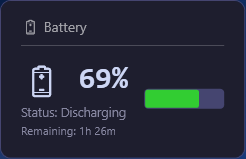
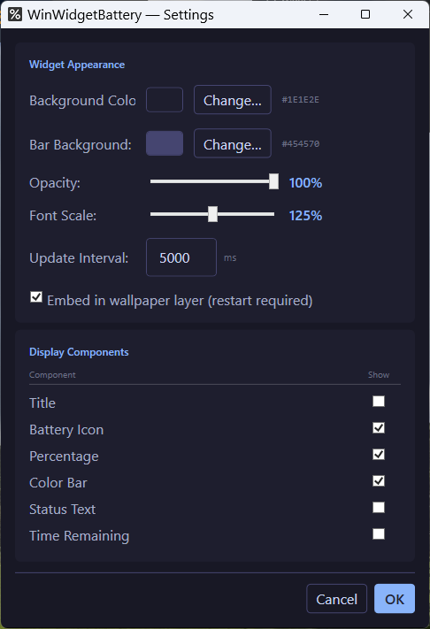

# WinWidgetBattery

A lightweight, transparent desktop widget that shows your PC's battery at a glance: charge level,
charging state and time remaining, plus the battery levels of your Bluetooth and USB mice,
keyboards, headsets and controllers, right on your wallpaper.

- **Battery at a glance:** percentage, charging or discharging, and estimated time remaining.
- **Color-coded bar:** green when charging or above 50%, yellow from 20 to 49%, red below 20%.
- **Device batteries:** battery levels of paired Bluetooth and plugged-in USB devices that report
  one.
- **Sleep countdown:** optionally shows how long until your PC sleeps or hibernates from inactivity.
- **Yours to style:** colors, opacity, size, font scale and which parts are shown. Run several
  widgets on several monitors.
- **Private by design:** no account, no ads, no telemetry, and no internet connections. See the
  [privacy policy](privacy.html).
- **Free and open source** under the Apache 2.0 license.

## Download

Windows 10 or 11, x64 or ARM64. No .NET runtime needed.

- [Download the portable zip](https://github.com/landenlabs/win-widget-battery/releases/latest/download/WinWidgetBattery.zip):
  extract it and run `WinWidgetBattery.exe`
- [All releases](https://github.com/landenlabs/win-widget-battery/releases): MSIX installers (x64
  and ARM64) and older versions
- [Installation help](https://github.com/landenlabs/win-widget-battery/blob/main/how-to-install.md)

## Using it

| Action | Result |
| --- | --- |
| Hover | Shows the Settings (⚙) and About (?) buttons |
| Click the battery icon | Opens the battery page in Windows Settings |
| Drag the widget | Moves it (Windows 11; on Windows 10 use the position map in Settings) |
| Drag a bottom corner | Resizes it (scales the text) |
| Right-click | Usage, Settings, About, Remove, Exit |
| System tray icon | Add another widget, open Settings, or exit |

## Support

- [Report a problem or ask a question](https://github.com/landenlabs/win-widget-battery/issues)
- [Source code and documentation](https://github.com/landenlabs/win-widget-battery)
- [Privacy policy](privacy.html)

&copy; 2026 LanDen Labs. Licensed under Apache-2.0.
